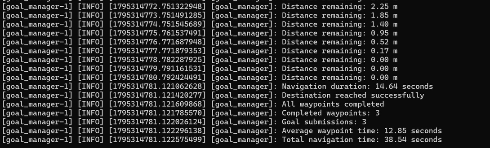

# ROS 2 Autonomous Waypoint Navigation

An autonomous waypoint navigation controller developed using **ROS 2 Jazzy, Python, Nav2 and Gazebo Harmonic**. The project demonstrates sequential autonomous navigation, navigation goal management, failure handling and performance monitoring using a simulated TurtleBot3 robot.

## Video Demonstration

The demonstration shows the TurtleBot3 autonomously navigating through three configured waypoints in Gazebo, with RViz navigation visualisation and live ROS 2 terminal feedback.

https://github.com/user-attachments/assets/c9b99223-5cf8-40d3-b7fb-2a3cf1d5d5b2

**Final demonstration results**

| Metric | Result |
|---|---|
| Video duration | 52.73 seconds |
| Waypoints completed | 3/3 |
| Goal submissions | 3 |
| Total navigation time | 38.54 seconds |
| Average waypoint time | 12.85 seconds |
| Navigation outcome | Successful |

[Download the original demonstration video (v1.0.0)](https://github.com/NIMIJITHNJ/ros2-autonomous-waypoint-navigation/releases/tag/v1.0.0)

## Project Overview

This project implements a high-level autonomous navigation controller for a simulated TurtleBot3 robot.

The custom ROS 2 Python node, `GoalManager`, communicates with the Nav2 navigation stack through the `NavigateToPose` action interface.

The controller manages waypoint sequencing, submits navigation goals, monitors progress, processes navigation results and responds to selected failure conditions.

Nav2 provides the underlying path planning, obstacle avoidance and robot navigation capabilities.

## Key Features

- **Autonomous waypoint navigation:** Executes multiple destinations sequentially without manual intervention.
- **Configurable destinations:** Waypoints can be modified using ROS 2 parameters and YAML configuration.
- **Navigation feedback:** Monitors remaining distance and navigation status.
- **Failure handling:** Supports goal retries, configurable timeouts and cancellation handling.
- **Server availability monitoring:** Handles temporary navigation server unavailability with configurable retry behaviour.
- **Performance monitoring:** Records navigation duration, completed waypoints and goal submissions.
- **Launch automation:** Uses a ROS 2 launch file and configuration parameters.
- **Automated testing:** Includes tests for waypoint validation, navigation outcomes and recovery behaviour.

## System Architecture

The controller coordinates navigation through the following components:

1. **YAML configuration:** Provides waypoint coordinates, timeout settings and retry parameters.
2. **GoalManager:** Manages navigation goals, waypoint progression and failure handling.
3. **Nav2:** Performs path planning, navigation control and obstacle avoidance.
4. **Gazebo:** Simulates the TurtleBot3 robot and its environment.
5. **Navigation monitoring:** Records feedback, results and performance information.

[View the system architecture diagram](docs/architecture.md)

## Simulation Screenshots

**Gazebo and RViz during autonomous navigation**


**Nav2 map, costmap and navigation visualisation**


**Successful waypoint completion and terminal results**



## Technologies

| Technology | Purpose |
|---|---|
| ROS 2 Jazzy | Robotics middleware |
| Python / rclpy | Navigation controller implementation |
| Nav2 | Path planning and navigation |
| Gazebo Harmonic | Robot simulation |
| TurtleBot3 Waffle | Simulated mobile robot |
| YAML | Navigation configuration |
| Pytest / colcon | Automated testing and build verification |

## Installation

### Prerequisites

- Ubuntu 24.04
- ROS 2 Jazzy
- Nav2 and `nav2_bringup`
- Gazebo Harmonic
- TurtleBot3 simulation packages, including `nav2_minimal_tb3_sim`
- Python 3 and colcon

### Clone the repository

```bash
cd ~
git clone https://github.com/NIMIJITHNJ/ros2-autonomous-waypoint-navigation.git robot_nav_ws
cd ~/robot_nav_ws
```

### Install package dependencies

```bash
source /opt/ros/jazzy/setup.bash
rosdep install --from-paths src --ignore-src -r -y
```

The Gazebo and Nav2 simulation packages must also be installed separately.

### Build the workspace

```bash
colcon build --packages-select robot_nav_controller --symlink-install
source install/setup.bash
```

## Running the Simulation

### Terminal 1 - Start Gazebo and Nav2

```bash
source /opt/ros/jazzy/setup.bash
source ~/robot_nav_ws/install/setup.bash

ros2 launch nav2_bringup tb3_simulation_launch.py \
  headless:=False \
  params_file:=$HOME/robot_nav_ws/config/nav2_params.yaml \
  autostart:=true
```

### Terminal 2 - Start the autonomous controller

```bash
source /opt/ros/jazzy/setup.bash
source ~/robot_nav_ws/install/setup.bash

ros2 launch robot_nav_controller navigation.launch.py
```

The controller loads the configured waypoints and sends navigation goals sequentially.

## Navigation Configuration

Navigation settings are defined in:

`src/robot_nav_controller/config/controller.yaml`

The configuration includes:

- `waypoint_coordinates` - destination coordinates
- `max_retries` - maximum retry attempts
- `goal_timeout` - navigation timeout in seconds
- `server_timeout` - Nav2 server connection timeout
- `retry_delay` - delay before retrying an unavailable server

Waypoint validation rejects empty coordinate lists, incomplete coordinate pairs and non-finite coordinate values.

After modifying the YAML configuration, restart the navigation controller to load the updated settings.

## Automated Testing

Run the package tests using:

```bash
cd ~/robot_nav_ws

colcon test --packages-select robot_nav_controller
colcon test-result --verbose
```

**Latest verified test results**

| Result | Count |
|---|---:|
| Passed | 15 |
| Skipped | 1 |
| Failed | 0 |

The tests cover waypoint validation, retry behaviour, navigation status handling and selected timeout and cancellation scenarios. Code-quality checks include Flake8 and PEP257.

## Customised Blue TurtleBot3

An optional blue TurtleBot3 model is provided under:

`custom_models/gz_waffle_blue.sdf.xacro`

To use the customised appearance, start the simulation with:

```bash
cd ~/robot_nav_ws

ros2 launch nav2_bringup tb3_simulation_launch.py \
  headless:=False \
  params_file:=$PWD/config/nav2_params.yaml \
  autostart:=true \
  robot_sdf:=$PWD/custom_models/gz_waffle_blue.sdf.xacro
```

Then start the navigation controller in a separate terminal.

The customisation modifies the robot's visual material without intentionally changing its collision geometry, sensors or physics.

## Limitations

- The system has been evaluated in Gazebo simulation, not on physical robot hardware.
- Path planning and obstacle avoidance are provided by Nav2 rather than custom navigation algorithms.
- Recovery handling covers selected failures but has not been comprehensively validated for production deployment.
- The demonstration represents a successful simulation run rather than a statistical evaluation across repeated experiments.

## Research Motivation

This project was developed to gain practical experience with robotics middleware, autonomous navigation, task execution, simulation and reliability testing.

It complements my academic background in machine learning, AI planning and decision-making under uncertainty, providing practical experience relevant to further research in autonomous systems.

## Licence and Acknowledgements

The ROS 2 controller package is distributed under the Apache-2.0 licence.

The project uses ROS 2, Nav2, Gazebo and TurtleBot3 simulation resources. The customised robot model and navigation configuration are adapted from existing ROS 2/Nav2 resources.

See [Third-Party Notices](THIRD_PARTY_NOTICES.md) for attribution and additional details.
