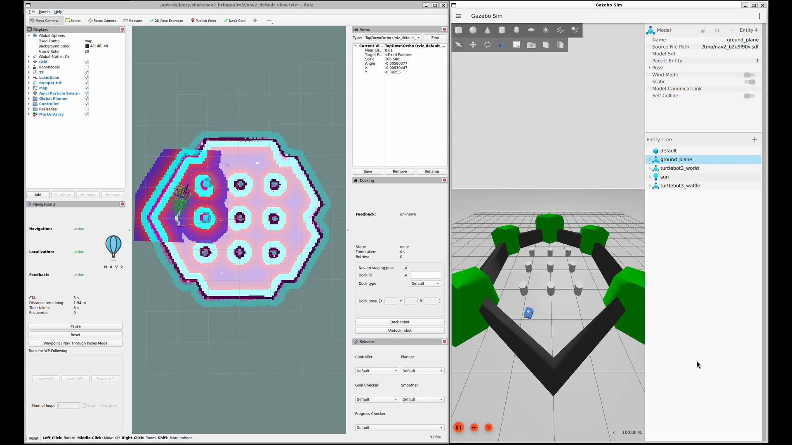
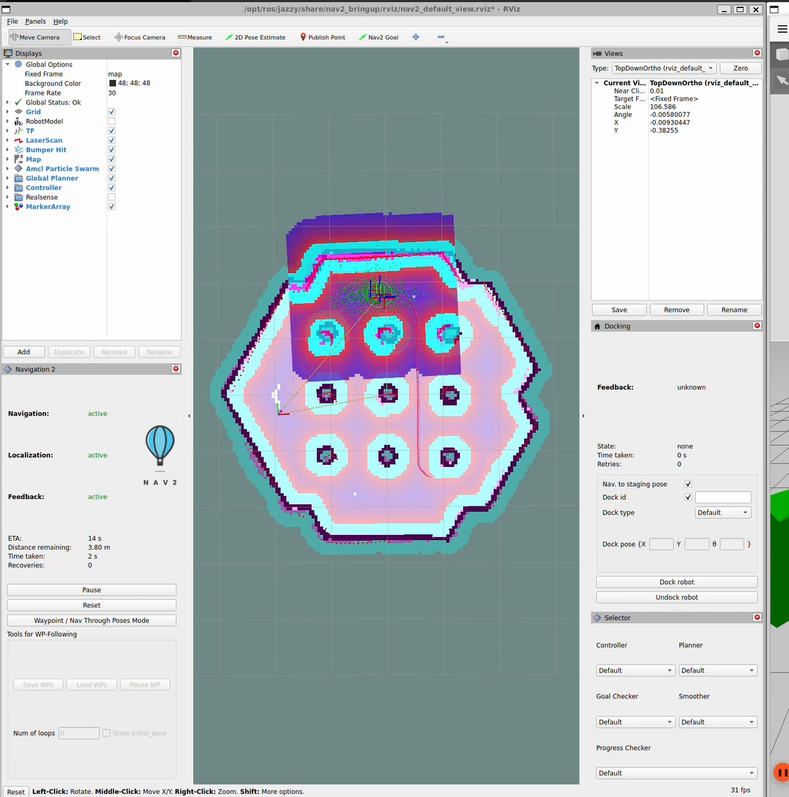

# ROS 2 Autonomous Waypoint Navigation

An autonomous waypoint navigation controller developed using ROS 2 Jazzy, Python, Nav2, and Gazebo Harmonic.

## Simulation Screenshots

The screenshots below were extracted from the [v1.0.0 demonstration video](https://github.com/NIMIJITHNJ/ros2-autonomous-waypoint-navigation/releases/tag/v1.0.0).

**RViz and Gazebo during autonomous navigation**



**Nav2 map, costmap and navigation in RViz**



**Completed navigation — terminal results**


## Video Demonstration

[Watch the autonomous navigation demonstration (v1.0.0)](https://github.com/NIMIJITHNJ/ros2-autonomous-waypoint-navigation/releases/tag/v1.0.0)

The demonstration shows TurtleBot3 completing three autonomous waypoints in Gazebo using ROS 2 and Nav2.

**Recorded results:** 3/3 waypoints completed, 3 goal submissions, and 38.54 seconds total navigation time.

[View the system architecture](docs/architecture.md)

## Overview

The project demonstrates autonomous sequential navigation of a simulated TurtleBot3 robot. A custom ROS 2 Python node manages waypoint execution, communicates with Nav2 using actions, monitors navigation feedback, and handles selected failure conditions.

## Features

- Autonomous sequential waypoint navigation
- Configurable waypoints using ROS 2 parameters
- YAML configuration and ROS 2 launch file
- Navigation feedback and completion monitoring
- Goal retries and configurable timeouts
- Basic goal cancellation and failure handling
- Navigation duration and waypoint completion metrics
- Automated tests for retry behaviour and waypoint validation

## Technologies

- ROS 2 Jazzy
- Python and rclpy
- Navigation2 (Nav2)
- Gazebo Harmonic
- TurtleBot3 simulation
- Pytest and colcon

## Installation

Requires Ubuntu 24.04, ROS 2 Jazzy, Nav2, and a working TurtleBot3 Gazebo simulation.

Clone this repository into a ROS 2 workspace, or use the included workspace layout.

Build the controller:

```bash
cd ~/robot_nav_ws
source /opt/ros/jazzy/setup.bash
colcon build --packages-select robot_nav_controller --symlink-install
source install/setup.bash
```

## Running

Start the TurtleBot3 simulation with Nav2:

```bash
ros2 launch nav2_bringup tb3_simulation_launch.py headless:=False params_file:=$HOME/robot_nav_ws/config/nav2_params.yaml autostart:=true
```

In a second terminal:

```bash
source /opt/ros/jazzy/setup.bash
source ~/robot_nav_ws/install/setup.bash
ros2 launch robot_nav_controller navigation.launch.py
```

Edit `src/robot_nav_controller/config/controller.yaml` to configure waypoints, retry limits, and timeout settings.

## Testing

```bash
cd ~/robot_nav_ws
colcon test --packages-select robot_nav_controller
colcon test-result --verbose
```

Latest verified result: 15 tests passed, 1 skipped, and 0 failures.

## Simulation Results

In one successful three-waypoint demonstration:

- Waypoint 1: 12.72 seconds
- Waypoint 2: 14.00 seconds
- Waypoint 3: 14.65 seconds
- Total navigation time: 41.36 seconds
- Successful waypoints: 3/3

These are results from one simulation run, not an average across repeated experiments.

## Project Scope

This project implements a high-level autonomous waypoint controller. Nav2 provides the underlying path planning and navigation capabilities. The project has been evaluated in simulation, not on physical robot hardware.

## Research Motivation

This project explores autonomous task execution, AI planning integration, navigation reliability, and decision-making in robotic systems.

## Optional Blue TurtleBot3 Model

A customised blue TurtleBot3 model is included in `custom_models/`.

To launch the simulation with this appearance:

```bash
cd ~/robot_nav_ws

ros2 launch nav2_bringup tb3_simulation_launch.py \
  headless:=False \
  params_file:=$PWD/config/nav2_params.yaml \
  autostart:=true \
  robot_sdf:=$PWD/custom_models/gz_waffle_blue.sdf.xacro
```

Then launch the navigation controller in another terminal:

```bash
ros2 launch robot_nav_controller navigation.launch.py
```

The colour modification is visual only and does not change
the robot's navigation behaviour.
