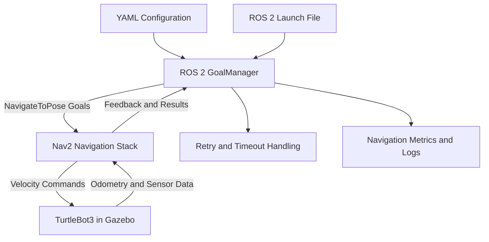

# System Architecture

The system uses a custom ROS 2 waypoint controller to coordinate autonomous navigation through the Nav2 action interface.

## Components

- **GoalManager:** Manages waypoint sequencing, goal submission, retries, timeouts and navigation feedback.
- **Nav2:** Provides path planning, control and navigation execution.
- **Gazebo:** Simulates the TurtleBot3 robot and its environment.
- **YAML Configuration:** Defines waypoint coordinates and reliability parameters.
- **Monitoring:** Records navigation durations, goal submissions and completion status.

## Scope

The project implements high-level autonomous waypoint management using existing Nav2 navigation capabilities. Testing has been performed in simulation rather than on physical robot hardware.
